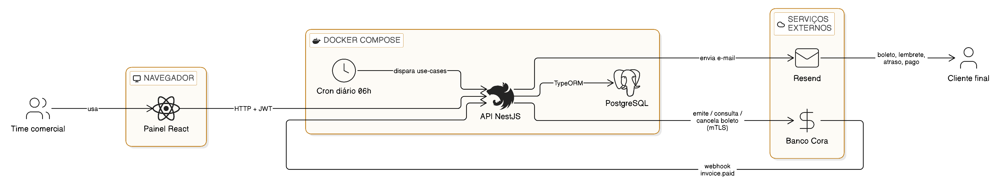
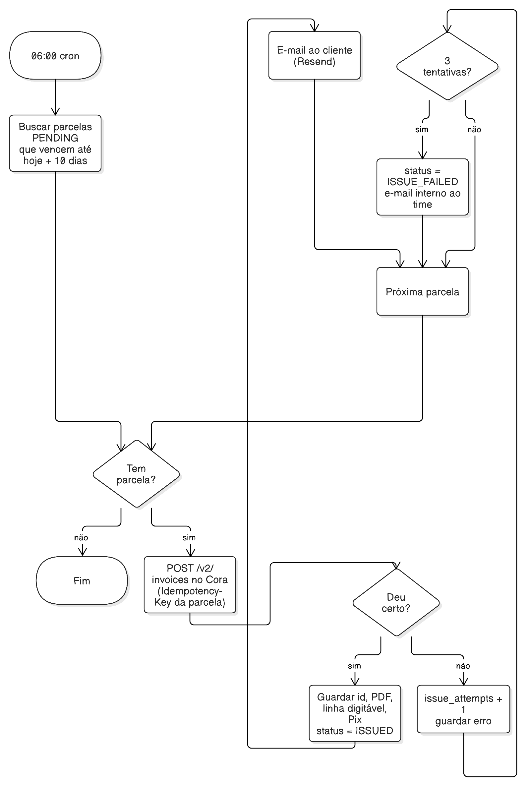
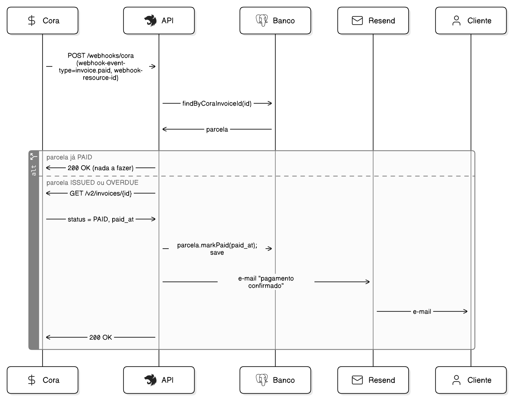
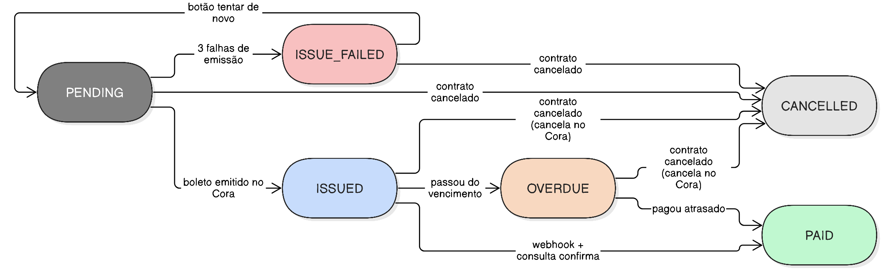
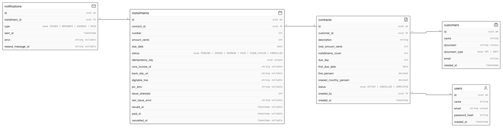
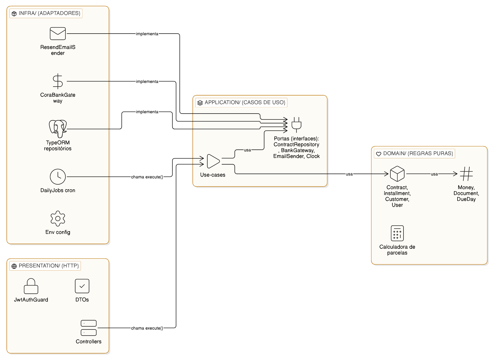

# Arquitetura — Cobrança automática via Cora

> Leia este documento inteiro uma vez antes de escrever código. Ele explica **o que** o sistema faz e **por que** está organizado assim. O "como fazer passo a passo" está no [GUIA-DO-DESENVOLVEDOR.md](GUIA-DO-DESENVOLVEDOR.md).

## 1. O problema

Quando um cliente fecha um contrato parcelado (12x, 24x ou 36x), alguém do comercial entra no painel do Banco Cora **todo mês** e agenda o boleto daquela parcela na mão. É repetitivo, depende de alguém lembrar, e erra.

## 2. A solução em uma frase

Cadastra-se o contrato **uma vez**. Daí em diante o sistema emite cada boleto no Cora sozinho, manda o e-mail ao cliente e marca a parcela como paga quando o Cora avisa.

## 3. Visão geral



Peças:

| Peça | O que é | Onde roda |
|---|---|---|
| **Painel** | React + Vite. Telas de login, contratos e parcelas. | Navegador do time |
| **API** | NestJS + TypeScript. Toda a lógica. | Docker (`api`) |
| **Banco** | PostgreSQL. Contratos, parcelas, usuários. | Docker (`db`) |
| **Cora** | Banco externo. Emite boletos e avisa pagamentos. | Internet |
| **Resend** | Serviço de e-mail. | Internet |

Em desenvolvimento tudo roda na sua máquina com `docker compose`. Em produção, o mesmo `docker compose` roda num EC2 da AWS. Só o `.env` muda.

## 4. Os fluxos

### 4.1 Cadastro de contrato

O comercial preenche: cliente (nome, CPF/CNPJ, e-mail), descrição, valor total, número de parcelas, dia do vencimento, mês da primeira parcela, multa (%) e juros ao mês (%).

O sistema **cria todas as parcelas no banco na hora**, com status `PENDING`. Valor de cada uma = total ÷ parcelas; os centavos que sobram vão na última. Dia 31 em mês que não tem 31 vira o último dia do mês.

### 4.2 Emissão automática (todo dia às 06:00)



1. Busca parcelas `PENDING` que vencem nos próximos 10 dias (`ISSUE_DAYS_BEFORE_DUE`).
2. Para cada uma, chama o Cora para emitir o boleto.
3. Guarda o id do boleto, o link do PDF, a linha digitável e o Pix. Status vira `ISSUED`.
4. Manda e-mail ao cliente com o boleto.

Se o Cora falhar, a parcela ganha +1 em `issue_attempts` e tenta de novo no dia seguinte. Na 3ª falha vira `ISSUE_FAILED`, aparece em destaque no painel e um e-mail interno avisa o time. O botão "tentar de novo" zera o contador.

**Por que "nos próximos 10 dias" e não "exatamente daqui a 10 dias"?** Se o servidor estiver desligado num dia, o dia seguinte pega o que ficou para trás.

**Por que a `idempotency_key` é gerada antes de chamar o Cora?** Se a chamada der timeout e a gente tentar de novo, o Cora reconhece a mesma chave e não cria dois boletos.

### 4.3 Lembretes (mesma rotina diária)

- 3 dias antes do vencimento, se ainda `ISSUED`: e-mail de lembrete.
- 1 dia depois do vencimento, se não paga: status vira `OVERDUE` e sai e-mail de atraso.

A tabela `notifications` registra cada e-mail enviado, para nunca mandar o mesmo duas vezes.

### 4.4 Pagamento (webhook do Cora)



O Cora faz um `POST /webhooks/cora` com o id do boleto no header. O sistema **não confia só no aviso**: consulta o boleto no Cora, e só se estiver `PAID` marca a parcela como paga e manda o e-mail de confirmação. Receber o mesmo aviso duas vezes não quebra nada.

### 4.5 Cancelamento de contrato

Contrato vira `CANCELLED`. Parcelas `PENDING` viram `CANCELLED`. Parcelas já emitidas são canceladas no Cora e depois no banco. Parcelas pagas ficam como estão.

## 5. Estados de uma parcela



```
PENDING ──emitiu──▶ ISSUED ──pagou──▶ PAID
   │                  │                 ▲
   │ 3 falhas         │ venceu          │ pagou
   ▼                  ▼                 │
ISSUE_FAILED        OVERDUE ────────────┘
   │ tentar de novo → PENDING
   └── qualquer estado, exceto PAID ──▶ CANCELLED
```

## 6. Banco de dados



| Tabela | Para quê |
|---|---|
| `users` | Quem faz login no painel. Senha guardada como hash bcrypt. |
| `customers` | Clientes. CPF/CNPJ único, só dígitos. |
| `contracts` | O que foi fechado: valor total, parcelas, dia de vencimento, multa, juros, status. |
| `installments` | Uma linha por parcela: valor, vencimento, status, dados do boleto, tentativas de emissão. |
| `notifications` | Cada e-mail enviado (tipo, parcela, quando, erro se houve). |

Dinheiro é **sempre inteiro em centavos**. R$ 10,01 = `1001`.

Alterações no banco só por migration do TypeORM (`npm run migration:generate`). Nunca `synchronize: true`.

## 7. Organização do código do backend (Clean Architecture)



A ideia: **a regra de negócio no centro, não sabe nada do mundo externo**. As setas de dependência apontam sempre para dentro.

```
src/
├── domain/        ← regras puras. Zero import de framework.
├── application/   ← casos de uso. Usam domain + "portas" (interfaces).
├── infra/         ← implementa as portas: TypeORM, Cora, Resend, cron.
└── presentation/  ← HTTP: controllers, guards, DTOs. Chama os casos de uso.
```

| Camada | Pode importar de | Nunca importa de |
|---|---|---|
| `domain` | nada | tudo o resto |
| `application` | `domain` | `infra`, `presentation` |
| `infra` | `application`, `domain` | `presentation` |
| `presentation` | `application`, `domain` | `infra` (recebe via injeção) |

**Porta e adaptador.** `application/ports/bank-gateway.ts` diz "preciso de alguém que emita boleto". `infra/cora/cora-bank-gateway.ts` é quem faz isso de verdade. O use-case nunca sabe que é o Cora. Nos testes, um fake em memória entra no lugar.

**Use-case.** Uma classe, um método `execute(input)`. Lista:

| Use-case | Disparado por |
|---|---|
| `LoginUseCase` | `POST /auth/login` |
| `CreateContractUseCase` | `POST /contracts` |
| `IssueDueInstallmentsUseCase` | cron diário |
| `SendRemindersUseCase` | cron diário |
| `HandleCoraWebhookUseCase` | `POST /webhooks/cora` |
| `CancelContractUseCase` | `POST /contracts/:id/cancel` |

Cada pasta tem um `README.md` curto explicando o seu papel.

## 8. API do Cora (o que importa para nós)

Documentação: https://developers.cora.com.br

- **Pré-requisito:** plano Cora Pro e certificado emitido no painel. Stage e produção têm credenciais diferentes.
- **Login:** `POST {CORA_TOKEN_URL}` com `grant_type=client_credentials&client_id=...`, apresentando o certificado e a chave privada na conexão (mTLS). Devolve `access_token` que dura 24h.
- **Emitir boleto:** `POST /v2/invoices` com header `Idempotency-Key`. Campos: `code` (nosso id), `customer` (name, email, document{identity, type}), `services[]` (name, description, amount **em centavos**), `payment_terms` (due_date `YYYY-MM-DD`, fine, interest), `payment_forms: ["BANK_SLIP","PIX"]`. Mínimo R$ 5,00. Resposta: `id`, `status`, `payment_options.bank_slip.url` (PDF), `.digitable`, `pix.emv`.
- **Consultar:** `GET /v2/invoices/{id}` → `status` em OPEN, PAID, LATE, CANCELLED.
- **Cancelar:** endpoint "Cancelamento de boleto v2".
- **Webhook:** cadastra-se a URL no Cora. Ele faz `POST` com headers `webhook-event-type` (ex.: `invoice.paid`) e `webhook-resource-id`. **Não há assinatura documentada**, por isso confirmamos consultando o boleto.
- **Testar sem dinheiro:** "Pagar boleto em stage" (https://developers.cora.com.br/reference/pagar-boleto-em-stage) simula o pagamento e dispara o webhook.

## 9. O que fica de fora da versão 1

WhatsApp · login do cliente · fila (Redis/BullMQ) · reajuste de valor · renegociação · relatórios · contratos antigos (só novos entram).

## 10. Decisões e por quê

| Decisão | Motivo |
|---|---|
| Um boleto por mês, não "carnê" | Carnê do Cora tem limite de 24 parcelas e dificulta cancelar no meio. |
| Nosso backend envia e-mail (Resend) | Controle do texto e dos lembretes. |
| Sem fila na v1 | Processo único dá conta; fila entraria só com várias instâncias ou volume alto. |
| Postgres no mesmo EC2 | Zero custo agora. Migrar para RDS ou agendar `pg_dump` quando houver dados reais. |
| Vitest, não Jest | É o que o NestJS 12 gera por padrão. |
